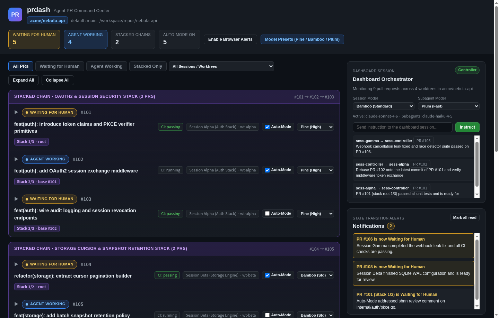
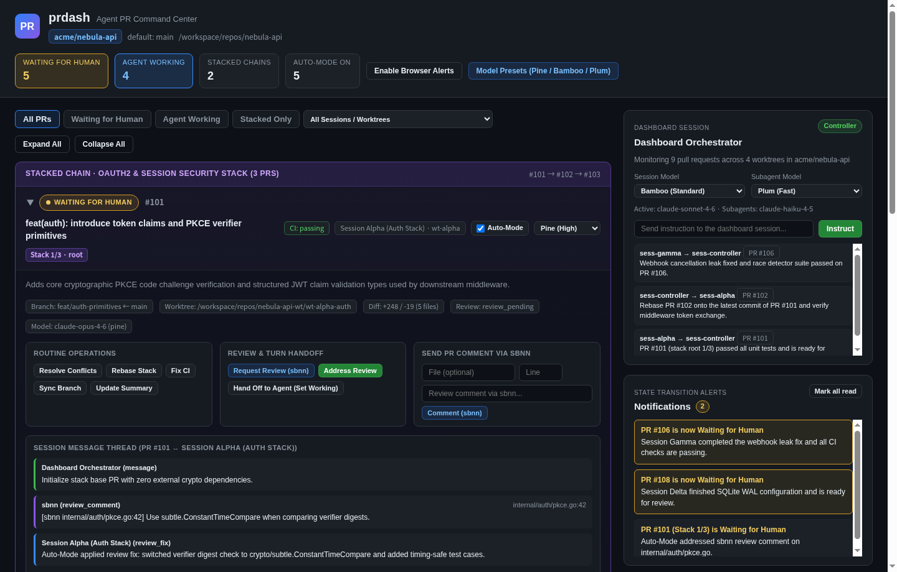

# prdash

**Coordinate pull requests with your coding agent through the prdash Skill.**

Load the [prdash Skill](skills/prdash/SKILL.md) into your agent, then ask it to open a dashboard for your repository. The agent starts prdash, shares the local URL, consumes instructions, and reports its results. You use the dashboard to inspect PRs and send instructions while the agent does the work.

> Use the prdash skill to open a dashboard for this repository. Show me the URL and handle the instructions I send through it.

The Skill is the entry point. The `prdash` command supplies the local dashboard and instruction queue used by the agent. CLI, HTTP, MCP, and Go APIs are also available for integrations.

## Install the Skill

The Skill ships inside the `prdash` binary, so its instructions match the installed command. Install the command and copy its Skill into the directory your agent loads:

```console
go install github.com/tenntenn/prdash@latest
prdash skill --install /absolute/path/to/your/skills-directory
```

The installer creates `prdash/SKILL.md` beneath that directory. Choose your agent's project-level or user-level skills directory. The Skill is a Markdown instruction file and is not tied to a particular agent provider.

Your agent needs shell access, `git`, and an authenticated `gh` for the target repository. The `go install` step requires the Go version declared in [go.mod](go.mod). Install `sbnn` if you want to use local diff reviews.

If your agent supports reading a Skill file directly, give it [skills/prdash/SKILL.md](skills/prdash/SKILL.md). The Skill includes command installation and update instructions.

## Ask your agent to operate the dashboard

Start with a repository and a concrete request:

> Use prdash for this repository. Discover the worktrees and open PRs, give me the dashboard URL, and wait for my instructions.

Then use the browser to inspect a PR, write an instruction, or request a routine operation. For example:

> Investigate the failing checks on PR #42, fix the cause, run the relevant tests, and report the result in prdash.

> Prepare PR #42 for review. Show the diff in sbnn and address the submitted feedback.

The agent follows this cycle:

1. Start the repository's dashboard and share its URL.
2. Inspect the PR, worktree, and assigned session before acting.
3. Consume queued instructions using the Skill's `wait` / `instructions` workflow.
4. Perform the requested work, verify it, and report the result.
5. Return to waiting for the next instruction or a human decision.

Keep the controller agent session running while you want it to consume instructions. An open browser does not itself execute queued work. Worktree-derived session entries are dashboard identifiers; they do not establish a connection to an existing agent conversation. Workers must consume their assigned instructions or use an explicit runtime integration.

Model presets express a configuration choice, not proof of which model a live agent is using. Changing a dashboard setting alone does not establish that the runtime applied it.

See [PR search](docs/search.md) for searchable fields and matching rules.

## What you see in the dashboard

- PRs grouped by stack, with CI, review information, and the next actor.
- Worktrees and session assignments for each PR.
- A controller conversation and PR-specific instruction threads.
- Review actions, routine-action requests, and notifications when a human decision is needed.

A “Waiting for Human” badge identifies the next actor; inspect the report and technical checks to determine whether the PR is ready to merge.

### Overview



### PR details and review discussion



Screenshots use example data. A new dashboard shows the repository's actual open PRs; a repository without open PRs starts with an empty list.

## Update the Skill

Ask your agent:

> Update the prdash command and its installed Skill to the latest version.

Or update them directly:

```console
go install github.com/tenntenn/prdash@latest
prdash skill --install /absolute/path/to/your/skills-directory --force
```

Use `--force` to replace an installed Skill. To inspect the embedded instructions without installing them, run `prdash skill` or `prdash skill --list`.

## Integrations and development

See the [CLI and integration reference](docs/integrations.md) for manual commands, flags, MCP configuration, and the Go package. The [Skill](skills/prdash/SKILL.md) contains the agent's operating procedure.

Development tools are managed with [aqua](https://aquaproj.github.io/). Install them with `aqua i` and use:

```console
task build     # build the command and embedded Skill
task check     # run go fix, goimports, go vet, and go test -race
task ui:docs   # regenerate screenshots from example data
```
